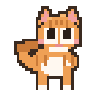

# Neko · Pixel Orange Cat Desktop Companion

[简体中文](README.md) · [GitHub](https://github.com/gddgssdfg/neko) · [Gitee](https://gitee.com/gddgssdfg/neko)

**Neko is a desktop pet and work companion for Windows 10/11.** An interactive pixel orange cat stays on your desktop while you type, organize tasks, focus, and take breaks. You can also customize its appearance, install plugins, and create your own skins.



## What can you use it for?

| Use | Features |
| --- | --- |
| Desktop company | Pet and drag the cat, let its eyes follow your cursor, and enjoy animated poses and screen-edge interactions. |
| Typing and mouse feedback | An optional panel shows keyboard and mouse activity. Adjust the cat and keyboard sizes independently. |
| Focus and breaks | A Pomodoro timer supports pause, resume, and manually started breaks. Locking or suspending the computer pauses the timer; resume it manually when you return. |
| Everyday organization | Keep a to-do list and notes. Start a focus session from an unfinished task; finishing the timer does not automatically mark the task complete. |
| A quieter desktop | Switch between work and relaxed modes, enable quiet mode, recover an off-screen cat, and back up appearance and interaction preferences. |
| Customization and creation | Import skins and plugins. Use the skin workbench to play animations, inspect individual frames, edit eye-layer anchors with backup before saving, inspect gaze limits and masks, validate assets, and export skin packages. |

The project includes 18 built-in plugins, covering focus, tasks, notes, weather, system information, and other tools. Manage them as needed. Clipboard recording and automatic update checks are unchecked by default during first-run setup.

## Getting started

**Platform: Windows 10/11, x64.** Neko uses C#, WPF, and .NET 8. macOS and Linux are currently unsupported.

1. Check [GitHub Releases](https://github.com/gddgssdfg/neko/releases) for publicly released installers or portable packages. Source updates may precede packaged releases; if no public package is available, build from source below.
2. Launch Neko and complete first-run setup. Default names are available.
3. Right-click the cat to open its menu, use the system tray to access settings, and drag the cat to reposition it.
4. Open the focus timer or to-do list from the menu. In Settings → Appearance, change skins, adjust sizes, or open the skin workbench.

Focus progress lasts only for the current app run. Closing the timer panel keeps the timer running; exiting Neko or disabling the Pomodoro plugin discards the current progress. Extract skin ZIP packages before importing the folder containing `skin.json`.

This README is available in English; the application interface and most detailed developer guides are currently primarily in Chinese.

## Privacy and extensions

- Pet animations, focus sessions, and local tools work offline. No Neko account is required; the app has no ads or usage telemetry sent to the author.
- Global keyboard and mouse listeners support hotkeys, animations, input feedback, and local activity reminders. Raw keystroke content and mouse trajectories are neither saved nor uploaded.
- Clipboard recording requires an explicit opt-in. Once enabled, recordings stay on your computer and can be paused, cleared, or expired automatically.
- Weather, web search, AI consultation, and update checks can access the network when triggered. See the [privacy notice](PRIVACY.md), currently in Chinese, for details.
- DLL plugins execute local code and are not sandboxed. Only install plugins from trusted sources. Imported plugins remain disabled until you enable them manually.

User data is stored in `%AppData%\Neko` by default; portable packages use a `data/` folder alongside the app. Find the actual location in Settings → About → Data directory. See the [security policy](SECURITY.md) for reporting vulnerabilities.

## Run from source

You need Windows, the .NET 8 SDK, and Python 3. Run these PowerShell commands:

```powershell
git clone https://github.com/gddgssdfg/neko.git
cd neko
$env:PythonExe = (Get-Command python).Source
dotnet run --project src/DesktopPet.App/DesktopPet.App.csproj -c Debug
```

The build generates and deploys the built-in plugins. You may use the Gitee clone URL instead if you have access to that repository. See [development and maintenance](docs/development.md) for builds, tests, asset tools, and packaging. The [app project file](src/DesktopPet.App/DesktopPet.App.csproj) defines the current source version; see the [changelog](CHANGELOG.md) for updates.

## Documentation and direction

Most detailed guides below are currently in Chinese.

- [Focus and to-do integration](docs/focus-companion.md) · [Quiet mode and desktop recovery](docs/recovery.md)
- [Skin workbench](docs/skin-workbench.md) · [Skin development](docs/skin-development-guide.md) · [Motion and transitions](docs/skin-motion.md)
- [Plugin development](docs/plugin-development-guide.md) · [Plugin starter](templates/plugin-skeleton) · [Architecture](docs/architecture.md)
- [Roadmap](docs/roadmap.md) · [Release process](docs/release-sop.md)

Neko is under active development, with a focus on character animation, unobtrusive work companionship, and creator tools. The skin workbench supports previews, anchor editing, gaze and mask inspection, backups before saving, and packaging; eye-socket editing and chained runtime-transition previews remain planned work.

## Licensing

| Content | License |
| --- | --- |
| Source code and project text | [MIT](LICENSE); commercial use is permitted. |
| Art assets the project is entitled to license, unless separately marked | [CC BY-NC 4.0](LICENSE-ASSETS); attribution is required and use is non-commercial. Obtain separate permission or replace the assets for commercial use. |
| Third-party dependencies and separately marked content | Their respective licenses apply; see [third-party notices](THIRD-PARTY-NOTICES.txt). |

Neko is an independently developed project provided as is. Source changes are synchronized between GitHub and Gitee; release attachments, issues, and repository access settings are managed separately.
