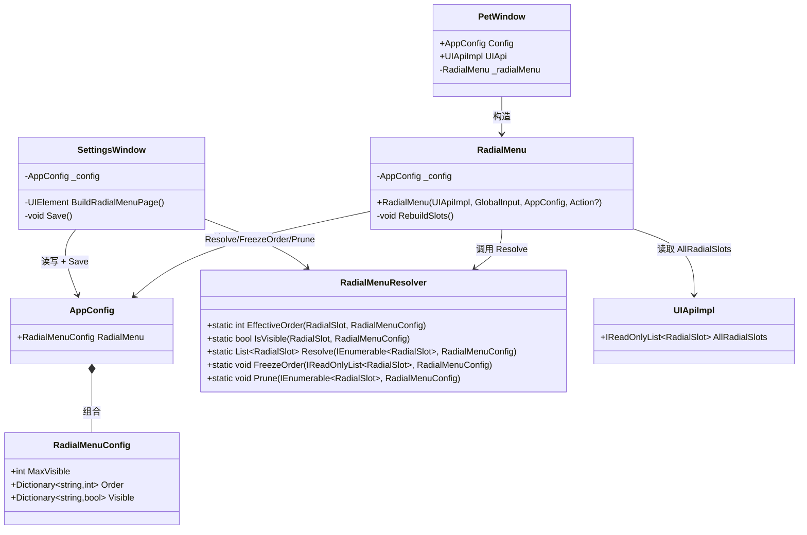
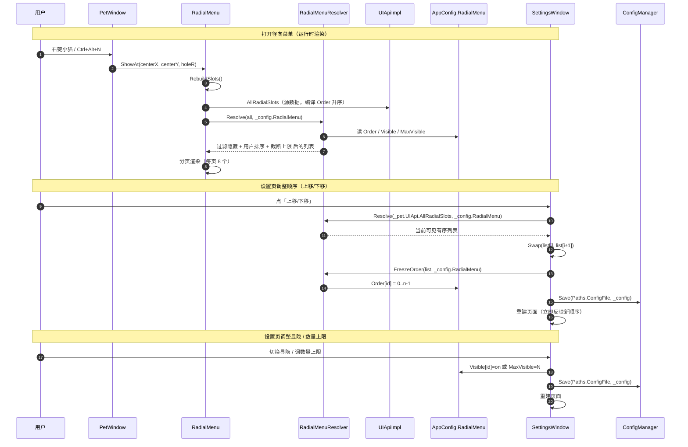

# Neko 架构文档（Architecture）

> 本文汇总《Neko》的整体架构、技术选型、分层、关键设计与设计决策。
> **合并自原 `desktop-pet-plan.md`（立项技术方案）+ `system_design.md`（径向菜单设计）+ 两份 mermaid 图。**
>
> | 项 | 值 |
> |---|---|
> | 运行环境 | Windows 10（1809+）+ .NET 8 + VS 2022 |
> | 分发范围 | 仅自用与朋友圈（受控分发，非开放创意工坊） |
> | 现状版本 | 以 `src/DesktopPet.App/DesktopPet.App.csproj` 的 `<Version>` 为准（本文不硬编码） |
> | 现行细节权威源 | 代码 / [`README.md`](../README.md) / [`CHANGELOG.md`](../CHANGELOG.md) / [`dev-log.md`](dev-log.md) / [`plugin-development-guide.md`](plugin-development-guide.md) |
>
> > ⚠️ **本文「第〇～九章 + 附录 A」里，凡标注「立项值」的参数/接口/清单，均为 2026-09-01 立项快照**，**不代表现状**；**附录 B** 逐条列出立项↔现状差异。现状一律以代码与上述权威源为准。

---

## 目录（TOC）

1. [现状速览](#1-现状速览)
2. [需求与设计原则](#2-需求与设计原则)
3. [技术选型：C# + WPF + .NET 8](#3-技术选型)
4. [分层架构](#4-分层架构)
5. [Core API（契约层）](#5-core-api契约层)
6. [宿主内核关键实现要点](#6-宿主内核关键实现要点)
7. [资源预算与发布形态](#7-资源预算与发布形态)
8. [径向菜单「顺序 / 显隐 / 数量上限」设计](#8-径向菜单顺序--显隐--数量上限设计)
9. [Win10 兼容性清单](#9-win10-兼容性清单)
10. [七阶段开发路线（历史）](#10-七阶段开发路线历史)
11. [附录 A：立项 19 项决策（2026-09-01 快照）](#附录-a立项-19-项决策)
12. [附录 B：立项 ↔ 现状差异校准](#附录-b立项--现状差异校准)

---

## 1. 现状速览

- **形态**：Windows 10 桌面宠物《Neko》，像素橘猫，常驻桌面；左键抚摸、右键径向菜单、托盘进完整设置。
- **技术栈**：C# + WPF + .NET 8（`net8.0-windows`）。
- **项目分层（4+1）**：`DesktopPet.Core`（契约）/ `DesktopPet.Runtime`（插件运行时）/ `DesktopPet.Sdk`（插件基类）/ `DesktopPet.App`（WPF 宿主 → `Neko.exe`）；插件源码在 `builtins/`，运行时产物在 `plugins/<id>/`。
- **当前版本能力**：9 个宠物状态动画、18 个内置插件（dogfooding）、径向菜单（每页 8 槽 + 分页 + 顺序/显隐/上限可配）、键鼠映射窗、气泡对话、皮肤系统（`neko-assets/<id>/skin.json` 零改码发现）、自动更新（Gitee 检查→提示→打开下载页）。
- **完整目录结构**：见 [`README.md`](../README.md)。

---

## 2. 需求与设计原则

### 2.1 需求要点

像素风小猫桌宠，常驻桌面。左键抚摸，右键径向菜单打开常用插件，托盘右键进完整设置。基础功能：眼神追踪、边缘吸附、键盘映射。扩展以插件形式增删、置顶。

### 2.2 硬约束（来自需求）

- **轻量、无感运行**：常驻内存红线、空闲 CPU 极低（现行数值见 §7.1）
- **可扩展性**：插件化，可自加可加给朋友
- **环境要求低**：不引入额外 SDK / 复杂工具链
- **仅桌面端**：无需考虑跨平台

### 2.3 三条不可妥协的工程原则（依然适用）

1. **Dogfooding（吃自己狗粮）**：所有内置功能必须以插件形式实现，与第三方插件走**完全相同**的加载路径。某个内置功能做不成插件 = API 有洞，补 API 绝不开后门。
2. **Core API 版本化从第一天开始**：插件 manifest 声明 `ApiVersion`，宿主做兼容层。**公开发布后只增不改**。
3. **插件崩溃与宿主隔离**：watchdog + 超时熔断是必做项。任一插件抛异常或死循环，宿主必须存活并提示「插件 X 已崩溃」。

---

## 3. 技术选型

### 3.1 C# + WPF + .NET 8（立项选型理由）

| 维度 | 评估 |
|---|---|
| 环境契合 | 已有 VS 2022 + .NET 扩展，C# 主力开发能力 |
| 原生能力 | WPF 原生支持透明无边框窗口、Layered Window、托盘（`Hardcodet.NotifyIcon.Wpf`）、全局热键（`User32.RegisterHotKey`） |
| 插件模型 | `AssemblyLoadContext` 可动态加载 + 卸载 .dll |
| 包体 | 依赖系统 .NET 8 Runtime 时 < 8 MB；自包含单文件 ~174 MB（现状） |
| 内存 | 工作集 50–80 MB（立项目标）；现状 ~177 MB（自包含形态，见 §7） |
| 启动 | 冷启动 < 500 ms（立项目标）；现状 ~668 ms |

### 3.2 与原 Tauri 方案的差异（决策翻转记录）

最初评估 Tauri 2（看中 WASM 沙箱），确认分发范围只是「自用 + 朋友」后，**沙箱的决定性理由消失** → 改用 C# + WPF。

| 维度 | 之前（Tauri 2） | 现在（C# WPF） |
|---|---|---|
| 沙箱 | 必需（WASM 能力式） | **不需要**（仅自用/朋友，签名+白名单即可） |
| 插件形态 | JS / WASM 双轨 | .NET 类库（单一形态） |
| 跨平台 | ✅ | ❌ Win only（用户接受） |
| 学习成本 | 需学 Rust | **零成本**（已有 C# 经验） |

**关键结论**：沙箱不是生死线后，插件系统可做得轻很多——`AssemblyLoadContext` + 接口契约 + manifest 文件，第三方安全靠「谁拿得到插件.dll」物理控制。

### 3.3 关键技术点

- **透明窗口**：`WindowStyle=None` + `AllowsTransparency=True` + `Background=Transparent`
- **鼠标穿透/捕获切换**：`User32.SetWindowLong` 配合 `WS_EX_LAYERED` / `WS_EX_TRANSPARENT`
- **DPI 适配**：WPF 自动感知 + `app.manifest` 声明 per-monitor v2；**物理↔DIP 坐标换算必须经 `CompositionTarget.TransformFromDevice`**（高频坑，见 `plugin-development-guide.md` 与 dev-log）
- **像素渲染**：`DrawingVisual` + `RenderTargetBitmap`，不走控件树，雪碧图 + 变换矩阵
- **系统托盘**：`Hardcodet.NotifyIcon.Wpf`
- **全局热键**：`User32.RegisterHotKey` + WndProc 钩子
- **开机自启**：`Microsoft.Win32.Registry` 的 `HKCU\...\Run`，避免 UAC
- **配置**：自写轻量 JSON（`System.Text.Json`）；插件 manifest 用 **TOML**（`Tomlyn`）

---

## 4. 分层架构

```
┌─ 插件生态 Plugin Layer ─────────────────────────────┐
│  内置插件（与第三方同权）   │  朋友/自写插件         │
│  builtins/ 编译产物         │  C# 类库 .dll          │
└──────────────────┬───────────────────────────────────┘
                   ↓
┌─ 插件运行时 Plugin Runtime（DesktopPet.Runtime）──────┐
│  清单解析 │ 生命周期 │ 版本校验 │ 权限/信任通道 │ 崩溃隔离+watchdog │
└──────────────────┬───────────────────────────────────┘
                   ↓
┌─ Core API · 唯一扩展契约（DesktopPet.Core，v1）────────┐
│  IPetApi          │ IUIApi            │ ICapabilityApi  │
│  动作表情气泡      │ 径向菜单托盘设置   │ 存储定时系统事件 │
└──────────────────┬───────────────────────────────────┘
                   ↓
┌─ 宿主内核 Host Core（DesktopPet.App，插件永不直接触碰）┐
│ 窗口管理 │ 像素渲染 │ 输入托盘 │ 行为物理 │ 配置     │
└──────────────────┬───────────────────────────────────┘
                   ↓
┌─ 运行时底座 ────────────────────────────────────────┐
│  .NET 8 WPF · Windows 10 (1809+) · 系统托盘/热键     │
└──────────────────────────────────────────────────────┘
```

**铁律**：插件只能看到 Core API（`DesktopPet.Core` 的接口），**绝不引用 Host Core 任何类型**。Host Core 可重构不影响插件。

**项目引用关系（单向）**：

```
DesktopPet.App ─┬─→ DesktopPet.Core
                ├─→ DesktopPet.Runtime ─→ DesktopPet.Core
                └─→ DesktopPet.Sdk（宿主显式引用 Sdk，供插件 ALC 路由）
plugins/* ─────→ DesktopPet.Sdk ─→ DesktopPet.Core
```

`DesktopPet.Runtime` **不能**引用 `DesktopPet.App`（否则插件 DLL 反向依赖宿主）。Core 是唯一的「水陆两栖」层。

---

## 5. Core API（契约层）

`DesktopPet.Core` 是**唯一扩展契约**（立项决策至今成立）。**全部签名逐字段以 [`plugin-development-guide.md`](plugin-development-guide.md) §2 为准**（那里逐字段对照源码）。

接口一览：

- `IPetPlugin` / `PluginBase`（`DesktopPet.Sdk`）：插件契约与基类。
- `IPluginContext`：`HostVersion` / `DataRoot` / `PluginDataDir` + 三个能力入口 `Pet` / `UI` / `Capability`（**没有第 4 个 `Log` 入口**；插件日志走 `Capability.System.Log`，v0.1.83）。
- `IPetApi`（宠物控制）/ `IUIApi`（界面注册）/ `ICapabilityApi`（存储/调度/系统/事件）。
- 权限模型：`[Flags] PluginPermissions`（v0.1.80 起底层类型 `ulong`）；**加载时校验**（高风险 `file`/`process` 拒载），加载后已授予范围内自由调用。

> ⚠️ 立项草案的接口定义（`PlayAnimationAsync(string, ...)`、`GetBounds()`、权限位 `1<<4/8/9/...` 等）**已过时**，见附录 B；**写插件请以 `plugin-development-guide.md` 为准，勿照草案编码**。

---

## 6. 宿主内核关键实现要点

- **渲染链路**：`SpriteAtlas`（雪碧图切帧）→ `FrameAnimator`（帧计时，`fps <= 0` 时帧永不推进 = 静止）→ `PetRenderer` / `DrawingVisualHost`（`Draw` 目标恒为 `32 × Scale` 逻辑框；皮肤源图由 WPF 自动缩放）。
- **状态机**：`PetStateMachine`（`Idle/Walk/Sit/Sleep/Pet/Drag/Fall/Climb/Work` 共 9 态）；空闲 30s→`Sit`、5min→`Sleep`；随机游走约 2% 概率。
- **物理**：抛物线落体（重力 1800 px/s²、反弹 0.35、`RestVelocity=100`、地面摩擦 `GroundFriction=0.6`、抛出限速 `MaxThrowSpeed=900`）。
- **输入层**：`GlobalInput`（`WH_KEYBOARD_LL` / `WH_MOUSE_LL` 低级钩子）；原始事件驱动键盘/鼠标映射窗高亮与「猫的反应」动画（均已做 300ms 节流，不吞键）。
- **浮层窗口**：`RadialMenu` / `InputMirrorWindow` / `BubbleWindow` / 爱心粒子窗口——**独立窗口 + 跟随猫**（`SyncFollowers`），渲染/窗口物理属宿主内核（架构铁律）。
- **线程模型**：定时器回调在**线程池**；`IPetApi` / `System.ReadClipboard` 已由宿主封送到 UI 线程；其余 UI 亲和操作插件须自行封送。详见 `plugin-development-guide.md` §5。
- **插件宿主**：`PluginLoader`（ALC 隔离 + `HostSharedAssemblies` 白名单）+ `PluginHost`（生命周期 / 懒加载 `LoadCore`+`LoadDeferred` / 信任清单 `LoadBuiltinTrust`）。

---

## 7. 资源预算与发布形态

### 7.1 硬指标（v0.1.60 起，红线已按桌面常驻场景调整）

| 指标 | 目标 | 红线 | 现状实测 |
|---|---|---|---|
| 安装包 / 体积（自包含单文件） | — | < 180 MB | ~174–175 MB（略超，按灯灯决策接受） |
| 常驻内存 | — | < 170 MB | ~177 MB（略超，自包含形态接受） |
| 空闲 CPU | < 0.5% | 2% | < 0.05%（远低于红线） |
| 冷启动 | < 1.5 s | 2.0 s | ~668 ms |

> 立项初值（安装包 < 8 MB / 常驻 50–80 MB / 冷启动 < 500 ms）是「依赖系统 Runtime」形态下的数字，**WPF 自包含形态下不适用**——见附录 B。

### 7.2 优化清单（.NET 8 + WPF 专项，已落地）

- **AOT/JIT**：`PublishReadyToRun=true`；`ServerGarbageCollection=false`、`ConcurrentGarbageCollection=false`（桌宠是工作站负载）。
- **WPF**：像素渲染走 `DrawingVisual` + `RenderTargetBitmap`（不建控件树）；透明窗口 + `WindowChrome`；`UseLayoutRounding` 抗高 DPI 发虚。
- **运行期**：鼠标采样节流；空闲时只在「帧真的推进 / 眨眼相位变化 / 瞳孔偏移」时重绘（`fps=0` 静止皮肤下闲置 CPU 增量 0.00%）；配置仅在变更时落盘（dirty flag）；插件懒加载（`LoadCore` / `LoadDeferred`）；禁用插件 `ALC.Unload()` 释放。
- **发布**：`PublishSingleFile=true` + `PublishSelfContained=true` + `EnableCompressionInSingleFile=false`（内存优先）+ `DebugType=embedded`；**不启用 trimming**（WPF 尚不友好）。

### 7.3 发布形态

**只发「自包含单文件」一种形态**（`PublishSelfContained=true` + `PublishSingleFile=true`）。

| 压缩 | 体积 | 稳态内存 | 结论 |
|---|---|---|---|
| `true` | ~80 MB | ~276 MB（启动解压运行时映射常驻） | ❌ 破内存红线 |
| `false` | ~174 MB | ~177 MB | ✅ **桌宠常驻，内存优先** |

> ⚠️ 必须用 `<PublishSelfContained>` 而**不是** `<SelfContained>`（后者是构建期属性，会让 Debug 构建产出「自包含非单文件」形态 → 插件 `AssemblyDependencyResolver` 失败 → **插件全丢**）。发布流程见 [`release-sop.md`](release-sop.md)。

---

## 8. 径向菜单「顺序 / 显隐 / 数量上限」设计

> 需求来源：灯灯——「关于插件顺序以及显示多少个插件的选项，应该加入设置里面，由客户自由选择要在右键界面显示多少插件，以及插件顺序」。
> 约束：Core API 只增不改，不得破坏现有 18 个插件的 `RegisterRadialSlot` 调用。（本设计已实现于 v0.1.71。）

### 8.1 实现思路与选型

| 难点 | 说明 |
|---|---|
| 顺序覆盖，不破坏插件 API | 插件声明的 `RadialSlot.Order` 是编译期写死常量。用户要在设置页覆盖它，但 `Core/RadialSlot` 与 `IUIApi.RegisterRadialSlot` 不能改（只增不改铁律）。 |
| 三件事统一成一个模型 | 「顺序」「显隐」「数量上限」相互影响，必须定义清晰的合成管线。 |
| 插件动态增减 | 用户配置是「跨插件全局」的，必须容忍槽位消失/新增。 |
| 宿主级持久化 | 顺序是跨插件全局的，存宿主 `AppConfig`（`data/config.json`），不能存插件私有目录。 |

**方案**：**覆盖层（overlay）**，而非改 `RadialSlot` 结构——宿主侧维护 `slotId → 用户Order`、`slotId → 显隐` 两张映射 + 一个数量上限字段；排序「用户值优先，缺省回退插件声明 `Order`」。**纯函数解析器（Resolver）** 与 `UIApiImpl` 解耦，便于 QA 单测。**不引入第三方库**（LINQ + `System.Text.Json` 即可）。

**关键语义决策**：「显示多少插件 / 数量上限 N」= **全局可见槽位总数上限**（排序+显隐后取前 N 个），**不是每页数量**；`N=0` 表示不限。**每页 8 个（`MaxPerPage=8`）保持不变**。

### 8.2 文件清单

| # | 路径 | 动作 | 职责 |
|---|------|------|------|
| 1 | `src/DesktopPet.App/Core/RadialMenuConfig.cs` | 新增 | 用户配置模型 `RadialMenuConfig` |
| 2 | `src/DesktopPet.App/Core/Config.cs` | 修改 | `AppConfig` 新增 `RadialMenu` 属性 |
| 3 | `src/DesktopPet.App/Services/RadialMenuResolver.cs` | 新增 | 纯函数解析器：顺序覆盖 / 显隐 / 上限截断 / 冻结顺序 / 清理残留 |
| 4 | `src/DesktopPet.App/Windows/RadialMenu.cs` | 修改 | 构造注入 `AppConfig`；`RebuildSlots` 改消费解析结果 |
| 5 | `src/DesktopPet.App/Windows/PetWindow.cs` | 修改 | 构造 `RadialMenu` 时传入 `_config` |
| 6 | `src/DesktopPet.App/Windows/SettingsWindow.cs` | 修改 | 新增「径向菜单」sidebar 项 + `BuildRadialMenuPage` |

**不改** `DesktopPet.Core` / `DesktopPet.Runtime` / `DesktopPet.Sdk`。

### 8.3 数据结构与接口

```csharp
// src/DesktopPet.App/Core/RadialMenuConfig.cs
public sealed class RadialMenuConfig
{
    public int MaxVisible { get; set; } = 0;                          // 全局可见上限，0=不限
    public Dictionary<string, int>  Order   { get; set; } = new();   // slotId → 覆盖顺序
    public Dictionary<string, bool> Visible { get; set; } = new();   // slotId → 是否显示
}

// src/DesktopPet.App/Services/RadialMenuResolver.cs（纯静态函数）
public static class RadialMenuResolver
{
    public static int  EffectiveOrder(RadialSlot slot, RadialMenuConfig cfg);           // 用户覆盖优先，否则插件 Order
    public static bool IsVisible(RadialSlot slot, RadialMenuConfig cfg);                 // 默认可见
    public static List<RadialSlot> Resolve(IEnumerable<RadialSlot> all, RadialMenuConfig cfg); // 主入口
    public static void FreezeOrder(IReadOnlyList<RadialSlot> orderedVisible, RadialMenuConfig cfg); // 物化用户顺序
    public static void Prune(IEnumerable<RadialSlot> all, RadialMenuConfig cfg);         // 清理残留 slotId
}
```

`Resolve` 管线（等价伪代码）：`过滤隐藏 → OrderBy(EffectiveOrder).ThenBy(Id, Ordinal) → 截断 MaxVisible（0=不限）`。

**类图：**



### 8.4 程序调用流程



### 8.5 跨切面约定（Shared Knowledge）

```
- Core API 只增不改：覆盖层全部在宿主（App）。
- 排序稳定：EffectiveOrder 平局按 slot.Id（StringComparer.Ordinal）兜底。
- 配置对象永不为 null：AppConfig.RadialMenu 用 = new() 初始化；STJ 缺失字段保留初始化值。
- 持久化统一走 ConfigManager.Save(Paths.ConfigFile, _config)（data/config.json）。
- 每页数量 MaxPerPage=8 是布局常量；MaxVisible 是全局可见总数上限，二者语义不同。
- Resolve 是唯一「槽位 → 展示列表」转化点；保存前调用 Prune 清理残留 slotId。
```

### 8.6 配置 JSON 示例（`data/config.json` 中新增段）

```json
{
  "RadialMenu": {
    "MaxVisible": 12,
    "Order": { "music-play": 0, "music-next": 1, "music-prev": 2, "fortune-today": 3 },
    "Visible": { "fortune-ai": false }
  }
}
```

---

## 9. Win10 兼容性清单

| 项 | 注意 |
|---|---|
| 最低版本 | Windows 10 1809 (Build 17763) |
| .NET 8 | 完全支持 |
| WPF 透明 | 需开启 `AllowsTransparency` + DWM 合成（Win10 默认开） |
| DPI | `app.manifest` 声明 `PerMonitorV2`；**物理↔DIP 换算必须经 `TransformFromDevice`**（125%/150% 缩放下 Win32 API 返回物理像素） |
| 鼠标穿透 | `WS_EX_LAYERED` + `WS_EX_TRANSPARENT` 标志切换 |
| 全局热键 | `RegisterHotKey` 无 UAC 弹窗 |
| 自启 | 写 `HKCU\Software\Microsoft\Windows\CurrentVersion\Run` 免 UAC |
| 托盘 | Win10 通知中心会自动收集托盘图标 |
| Alt+Tab | 桌宠窗口加 `WS_EX_TOOLWINDOW` 后不出现在 Alt+Tab（`WindowEx.HideFromAltTab`） |
| 屏幕缩放 | 175%/200% 下需手动验证雪碧图锐度 |

---

## 10. 七阶段开发路线（历史）

> 立项期的分阶段路线，**均已完成**，保留作历史与验收标准参考。

| 阶段 | 内容 | 验收标准 |
|---|---|---|
| **P0 技术验证** | 透明窗口、鼠标穿透、托盘、全局热键、内存基线 | 窗口贴边不抖，空闲内存达标 |
| **P1 宿主内核** | `DrawingVisual` 像素渲染、动画状态机、事件总线、配置读写 | 猫能走能拖能落，加载雪碧图 |
| **P2 插件系统** | `AssemblyLoadContext` 加载器、manifest 解析、版本校验、watchdog | 一个空插件装载并运行 |
| **P3 内置重构** ⭐ | 内置功能全部改写为插件 | 内置功能全插件化 → **API 冻结** |
| **P4 交互层** | 左键抚摸、状态机加分、右键径向菜单、托盘设置页 | 菜单可配置顺序、常用置顶 |
| **P5 打包分发** | 单文件发布、安装/卸载、注册表自启 | 拷一份即可用 |
| **P6 SDK 与模板** | 插件模板、API 参考、示例插件 | 能独立写出插件 |

**P3 是胜负手**——把内置功能强行改写为插件，一次性暴露 Core API 的全部漏洞；通过后才冻结 API。

---

## 附录 A：立项 19 项决策

> 2026-09-01 定稿，**至今仍然成立**（存档价值）。产品定位 / 功能范围 / 素材 / 工程分发四组。

### 产品定位

| 项 | 决策 |
|---|---|
| 宠物命名 | **Neko** |
| 外观风格 | 可爱橘猫 —— 橙白配色、圆脸大眼、粗描边（非纯黑描边） |
| 精灵尺寸 | 32×32 画布，放大整数倍显示（保持像素锐利，禁止非整数缩放） |
| 动画帧数 | 4 帧/状态循环 |

### 功能范围 v1

| 项 | 决策 |
|---|---|
| 首发功能 | 眼神追踪 + 边缘吸附悬挂 + 键盘映射 + 抚摸好感度（四项全上） |
| 空闲行为 | 待机 + 走动 + 坐下 + 睡觉（30s 坐下 / 5min 睡觉）+ 拖拽物理（甩动、抛物线落下） |
| 径向菜单 | 支持排序、常用置顶（现状：每页 8 槽 + 分页 + 顺序/显隐/上限可在设置页配，见 §8） |
| 说话气泡 | **做，仅插件驱动**（宿主只提供渲染，不做内置台词库） |
| 托盘菜单 | 只留常用项（现状见 `README.md`） |

### 素材

| 项 | 决策 |
|---|---|
| 来源 | 灯灯自绘（LibreSprite / Aseprite）；开发期用同构占位图跑通渲染管线 |
| 规格 | 8 状态 × 4 帧，眼球独立分层（现状：9 状态，皮肤契约见 `skin-development-guide.md`） |

### 工程与分发

| 项 | 决策 |
|---|---|
| 部署模式 | 见附录 B（现状：自包含单文件） |
| 配置文件 | **JSON**（`System.Text.Json`）；插件 manifest 用 **TOML** |
| 插件签名 | v1 不做，预留接口（现状：未采用 `.npet`/`SIGNATURE`，运行时不打包） |
| 开机自启 | **默认关**，在设置窗口里开启 |
| 清单 | 全部 19 项已确认，无遗留（A1–A4 命名/风格/尺寸/帧数；B1–B5 功能/行为/槽位/托盘/气泡；C1–C2 素材；D1–D5 部署/签名/配置/自启/分发；E1–E3 称呼/城市/风格） |

---

## 附录 B：立项 ↔ 现状差异校准

> 立项稿是 2026-09-01 的**设计与决策快照**，属历史存档。**漂移只发生在「实现细节」层面**——立项决策（附录 A）仍成立，此处列出**主要差异**，避免照旧值干活。

| 立项稿 | 现状 | 依据 |
|---|---|---|
| 宠物状态 **8 个** | **9 个** —— 新增 `Work` 工作模式（v0.1.48） | `src/DesktopPet.Core/Enums.cs` |
| 径向菜单**固定 8 槽位** | **每页最多 8 个、超出翻页** + 顺序/显隐/上限可配（v0.1.71） | `Windows/RadialMenu.cs` / §8 |
| 内置插件 **4 个** | **18 个**（quote/screenshot/pomodoro/sleep/search/wordcard/hourly/music/fortune/countdown/notes/todo/sysinfo/weather/bazi/affection/clipboard/colorpicker） | `builtins/` |
| 物理·**静止阈值 20 px/s** | **`RestVelocity = 100.0`**（差 5 倍）；新增地面摩擦 `GroundFriction = 0.6`（v0.1.59） | `Windows/PetWindow.cs` |
| 拖拽「释放速度继承系数 0.6 / 甩动保留 60%」 | **已不存在**：现行 `StartFall` 直接取「上一帧鼠标位移 × 60」为抛出初速（**100% 继承**，×60 只是单位换算），再限速 `MaxThrowSpeed=900` | `PetWindow.cs` |
| 目录 `plugins-src/` · `assets/` · `Window/` | **`builtins/` + `samples/`** · **`neko-assets/`** · **`Windows/`**；新增 `tests/PluginSmoke/`、`installer/` | 仓库实际结构 / `README.md` |
| 发布：依赖模式(8 MB)+自包含(35–50 MB) **两套** | **自包含单文件**（`PublishSelfContained=true`，~174 MB / 稳态内存 ~177 MB，v0.1.60 定稿） | `App.csproj` / `CHANGELOG` v0.1.60 |
| 托盘菜单「设置/暂停/关于/退出」 | 另含 **工作模式 / 显示·隐藏猫咪 / 插件…** 子菜单；其余（自启/穿透/缩放/透明度）下沉设置页 | `Services/TrayManager.cs` |
| Core API 草案（`PlayAnimationAsync(string)`、`GetBounds()`、权限位 `1<<4/8/9/...`） | 现行签名见 `src/DesktopPet.Core/` 与 [`plugin-development-guide.md`](plugin-development-guide.md)（新增 `PluginBase`、`IPluginContext` 三入口 `Pet/UI/Capability`；权限位已重排） | `plugin-development-guide.md` |
| 插件包 `.npet` + `SIGNATURE` | **未采用** —— 运行时即 `plugins/<id>/`（dll + `plugin.toml` 目录约定） | `plugins/README.md` |
| 资源红线：内存 < 120 MB / 冷启动 < 500 ms | 自包含形态下调整：内存红线 170 MB / 冷启动 2.0 s（见 §7.1，灯灯确认） | `CHANGELOG` v0.1.33 / v0.1.60 |

> 立项稿的 §4/§5/§8/§10/§12（接口草案、插件格式草案、项目结构草案、内置功能草案、启动提示词）均为历史存档，**勿照抄编码**——现行以本附录右列的依据源为准。

---

*文档版本：v1.0（合并技术方案 + 径向菜单设计 + 类图/时序图）｜ 基于 2026-09-01 立项稿与 v0.1.82 现状撰写。*
