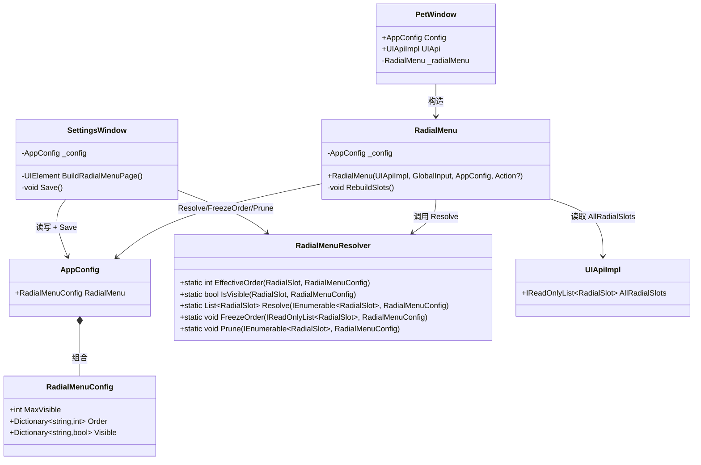
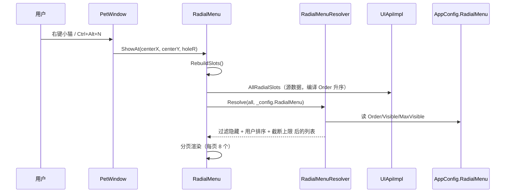
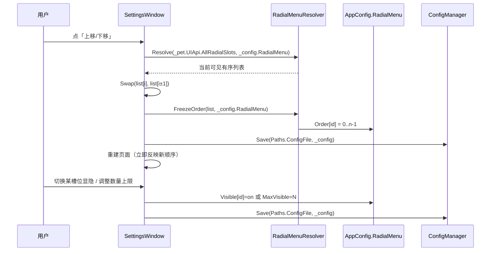

# Neko 径向菜单「顺序 / 显隐 / 数量上限」配置 —— 系统设计与任务分解

> 架构师：高见远（Bob）
> 需求来源：灯灯 ——「关于插件顺序以及显示多少个插件的选项，应该加入设置里面，由客户自由选择要在右键界面显示多少插件，以及插件顺序」
> 目标层：Windows 桌宠 Neko（C# / WPF / .NET 8）
> 约束：只做设计，不实现。Core API 铁律「只增不改」，不得破坏现有 18 个插件的 `RegisterRadialSlot` 调用。

---

## Part A：系统设计

### 1. 实现思路（Implementation Approach）

#### 1.1 核心技术难点

| 难点 | 说明 |
|------|------|
| **顺序覆盖，不破坏插件 API** | 插件声明的 `RadialSlot.Order` 是编译期写死常量（如 MusicControl 上一曲=2、Bazi 今日运势=30）。用户要在设置页覆盖它，但 `Core/RadialSlot` 与 `IUIApi.RegisterRadialSlot` 不能被改（只增不改铁律）。 |
| **三件事要统一成一个模型** | 「顺序」「显隐」「数量上限」三者相互影响，必须定义清晰的合成管线，避免出现「隐藏了又被上限截断」「排序里混进隐藏项」等歧义。 |
| **插件动态增减** | 插件可运行时启用/禁用、可新增/卸载。用户配置是「跨插件全局」的，必须能容忍槽位消失/新增，不产生崩溃或错乱。 |
| **宿主级持久化** | 顺序是跨插件全局的，不能存 `data/plugins/<id>/`（那是插件私有隔离），必须存宿主 `AppConfig`（`data/config.json`）。 |

#### 1.2 方案选型

- **覆盖层（overlay）方案，而非改 `RadialSlot` 结构**。宿主侧维护 `slotId → 用户Order`、`slotId → 显隐` 两张映射表 + 一个数量上限字段。排序时「用户值优先，缺省回退插件声明 `Order`」。这样 `Core API` 完全不动，18 个插件的 `RegisterRadialSlot` 调用原样可用。
- **纯函数解析器（Resolver）**，放在 `DesktopPet.App.Services`，与 `UIApiImpl` 解耦。`UIApiImpl.AllRadialSlots` 保持原样（原始 + 编译 Order 排序）作为「源数据」；解析器负责「过滤隐藏 → 用户排序 → 截断上限」。纯函数便于 QA 单测（无需 WPF 窗口）。
- **架构模式**：延续现有宿主分层（`Core` 契约 / `Services` 逻辑 / `Windows` 视图）。本功能新增一个「配置模型 + 解析器」数据层，消费点仅 `RadialMenu` 一处，设置入口在 `SettingsWindow`。
- **不引入第三方库**：`System.Text.Json` 已用于 `AppConfig`，字典序列化天然支持；排序/上限用 LINQ 即可，无需拖拽框架（用「上移/下移」按钮，零新依赖、深色主题下体验稳定）。

#### 1.3 关键语义决策（对应灯灯需求的歧义点）

**「显示多少插件 / 数量上限 N」= 全局可见槽位总数上限，不是每页数量。**

- 排序 + 显隐之后，取**前 N 个**显示，超出部分隐藏。
- `N = 0` 表示「不限制」（显示全部可见槽位）。
- **每页 8 个（`MaxPerPage=8`）保持不变**——这是用户此前明确要求的分页布局常量，不在本次「显示多少插件」语义内（若未来要每页可配，再另加字段，本次不做）。

---

### 2. 文件清单（File List）

> 共 6 个文件：3 新增 + 3 修改。**不改 `DesktopPet.Core`、`DesktopPet.Runtime`、`DesktopPet.Sdk`。**

| # | 路径 | 动作 | 职责 |
|---|------|------|------|
| 1 | `src/DesktopPet.App/Core/RadialMenuConfig.cs` | 新增 | 径向菜单用户配置模型 `RadialMenuConfig` |
| 2 | `src/DesktopPet.App/Core/Config.cs` | 修改 | `AppConfig` 新增 `RadialMenu` 属性 |
| 3 | `src/DesktopPet.App/Services/RadialMenuResolver.cs` | 新增 | 纯函数解析器：顺序覆盖 / 显隐 / 上限截断 / 冻结顺序 / 清理残留 |
| 4 | `src/DesktopPet.App/Windows/RadialMenu.cs` | 修改 | 构造注入 `AppConfig`；`RebuildSlots` 改消费解析结果 |
| 5 | `src/DesktopPet.App/Windows/PetWindow.cs` | 修改 | 构造 `RadialMenu` 时传入 `_config` |
| 6 | `src/DesktopPet.App/Windows/SettingsWindow.cs` | 修改 | 新增「径向菜单」sidebar 项 + `BuildRadialMenuPage` 设置页 |

---

### 3. 数据结构与接口（Data Structures & Interfaces）

#### 3.1 配置模型（新增 `RadialMenuConfig`）

```csharp
// src/DesktopPet.App/Core/RadialMenuConfig.cs
namespace DesktopPet.App.Core;

/// <summary>径向菜单的用户级覆盖配置（宿主级，跨插件全局）。</summary>
public sealed class RadialMenuConfig
{
    /// <summary>全局可见槽位总数上限（排序+显隐之后取前 N 个）。0 = 不限制。</summary>
    public int MaxVisible { get; set; } = 0;

    /// <summary>用户覆盖顺序：slotId → 显式顺序（越小越靠前）。缺省时回退插件声明的 Order。</summary>
    public Dictionary<string, int> Order { get; set; } = new();

    /// <summary>显隐覆盖：slotId → 是否显示（false=隐藏）。缺省时 = 显示。</summary>
    public Dictionary<string, bool> Visible { get; set; } = new();
}
```

`AppConfig` 追加（`Config.cs`）：

```csharp
// ---- v0.1.7x：径向菜单顺序/显隐/数量上限 ----
/// <summary>径向菜单配置（顺序覆盖 + 显隐 + 全局可见数量上限）。缺失配置时保持默认（不限/不覆盖）。</summary>
public RadialMenuConfig RadialMenu { get; set; } = new();
```

#### 3.2 解析器（新增 `RadialMenuResolver`，纯静态函数）

```csharp
// src/DesktopPet.App/Services/RadialMenuResolver.cs
using DesktopPet.App.Core;
using DesktopPet.Core;

namespace DesktopPet.App.Services;

/// <summary>
/// 径向菜单槽位的「用户配置 → 最终展示列表」解析器。
/// 覆盖层只存在于宿主，不改 Core API；插件声明的 Order 是默认基准。
/// </summary>
public static class RadialMenuResolver
{
    /// <summary>某槽位有效顺序：用户覆盖优先，否则回退插件 Order。</summary>
    public static int EffectiveOrder(RadialSlot slot, RadialMenuConfig cfg)
        => cfg.Order.TryGetValue(slot.Id, out var o) ? o : slot.Order;

    /// <summary>某槽位是否可见（默认可见）。</summary>
    public static bool IsVisible(RadialSlot slot, RadialMenuConfig cfg)
        => cfg.Visible.GetValueOrDefault(slot.Id, true);

    /// <summary>
    /// 主入口：过滤隐藏 → 按有效顺序排序（平局按 Id 稳定）→ 截断到 MaxVisible（0=不限）。
    /// 返回最终要在径向菜单里渲染的槽位列表。
    /// </summary>
    public static List<RadialSlot> Resolve(IEnumerable<RadialSlot> all, RadialMenuConfig cfg);

    /// <summary>
    /// 用户拖拽/上移下移后调用：把「当前可见有序列表」物化回 cfg.Order（index 0..n-1），
    /// 冻结用户顺序，跨重启稳定。只写可见项，隐藏项保留原 Order 以支持取消隐藏后恢复原位。
    /// </summary>
    public static void FreezeOrder(IReadOnlyList<RadialSlot> orderedVisible, RadialMenuConfig cfg);

    /// <summary>
    /// 清理残留：删除 cfg.Order / cfg.Visible 中已不存在的 slotId（插件卸载/改名后）。
    /// 保存前调用，避免配置无限膨胀。
    /// </summary>
    public static void Prune(IEnumerable<RadialSlot> all, RadialMenuConfig cfg);
}
```

`Resolve` 内部管线（等价伪代码）：

```csharp
var visible = all.Where(s => IsVisible(s, cfg));
var ordered = visible
    .OrderBy(s => EffectiveOrder(s, cfg))
    .ThenBy(s => s.Id, StringComparer.Ordinal);   // 稳定排序：平局按 Id
var list = ordered.ToList();
if (cfg.MaxVisible > 0 && list.Count > cfg.MaxVisible)
    list.RemoveRange(cfg.MaxVisible, list.Count - cfg.MaxVisible);
return list;
```

#### 3.3 类图



---

### 4. 程序调用流程（Program Call Flow）

#### 4.1 打开径向菜单（运行时渲染）



#### 4.2 设置页调整（顺序 / 显隐 / 上限）



---

### 5. Anything UNCLEAR（不明确点与已做假设）

1. **「显示多少插件」= 全局总数上限**：已按 team-lead 倾向明确为「排序+显隐后取前 N 个」。若灯灯实际想要的是「每页显示 N 个」，只需把 `Resolve` 的截断从「全局」改为「分页内」并把 UI 文案改为「每页个数」——但本次按全局上限实现。
2. **拖拽 vs 上移/下移**：本次用「上移/下移」按钮（零依赖、深色主题稳定、键盘可用）。若后续要拖拽，可在设置页列表外包一层拖拽控件，`FreezeOrder` 接口不变。
3. **隐藏槽位是否保留原顺序**：假设「保留」——取消隐藏后回到它隐藏前的显式顺序（若从未显式排序则回编译 Order）。若希望「取消隐藏后掉到末尾」，改 `FreezeOrder` 的写入范围即可。
4. **上限 N 的上界**：动态取当前可见槽位总数，UI 用 stepper（0=不限），不写死上限。
5. **设置页列表展示**：假设「可见槽位（有序、可上移下移、可隐藏）在上，隐藏槽位（置灰、仅可恢复显示）在下」，一条列表统一呈现，避免两套 UI。

---

## Part B：任务分解

### 6. 依赖包（Required Packages）

无需新增第三方包。仅使用项目现有：`System.Text.Json`（.NET 内置）、LINQ、WPF 基础控件。

### 7. 任务列表（按依赖顺序）

> 说明：本功能体量小（6 文件），拆 2 个任务、每个任务 ≥3 文件、任务间只有一条依赖边，符合「少依赖链、按功能分层」原则。T02 内按 a→b→c 顺序实现。

| Task ID | 任务名 | 源文件 | 依赖 | 优先级 |
|---------|--------|--------|------|--------|
| **T01** | 配置模型 + 解析器（数据层） | ① `Core/RadialMenuConfig.cs`（新增）② `Core/Config.cs`（修改，`AppConfig.RadialMenu`）③ `Services/RadialMenuResolver.cs`（新增） | 无 | P0 |
| **T02** | 宿主集成：径向菜单消费 + 设置页 UI | ④ `Windows/RadialMenu.cs`（修改）⑤ `Windows/PetWindow.cs`（修改）⑥ `Windows/SettingsWindow.cs`（修改） | T01 | P0 |

#### T01 详情 —— 配置模型 + 解析器

实现内容：

1. `RadialMenuConfig`：三个成员 `MaxVisible`（int，默认 0）、`Order`（`Dictionary<string,int>`）、`Visible`（`Dictionary<string,bool>`），均带非空初始化。
2. `AppConfig.RadialMenu` 属性 `= new()`。
3. `RadialMenuResolver`：
   - `EffectiveOrder` / `IsVisible` / `Resolve` / `FreezeOrder` / `Prune` 五个静态方法。
   - `Resolve`：`过滤隐藏 → OrderBy(EffectiveOrder).ThenBy(Id, Ordinal) → 截断 MaxVisible`。
   - `FreezeOrder`：把传入的可见有序列表写成 `Order[id]=index`。
   - `Prune`：删掉 `Order`/`Visible` 中不在 `all` 里的 key。

验收：编译通过；`Resolve` 对「隐藏 / 覆盖顺序 / 上限 / 平局」四类输入返回正确列表（可用临时控制台/QA 单测验证）。

#### T02 详情 —— 宿主集成（按序实现）

- **a) 消费接线 `RadialMenu.cs`**
  - 构造签名改为 `RadialMenu(UIApiImpl uiApi, GlobalInput input, AppConfig config, Action? onToggleMirror = null)`，存 `_config` 字段。
  - `RebuildSlots()` 中 `var all = _uiApi.AllRadialSlots;` 改为 `var all = RadialMenuResolver.Resolve(_uiApi.AllRadialSlots, _config.RadialMenu);`（`all` 已过滤/排序/截断；分页逻辑 `_pageCount`/`Skip/Take` 保持不变）。
- **b) 传参 `PetWindow.cs`**
  - `OpenRadialMenu()` 中 `_radialMenu ??= new RadialMenu(_uiApi, _globalInput, _config, onToggleMirror: ...)`。
- **c) 设置页 `SettingsWindow.cs`**
  - `BuildSidebar()` 的 `sections/labels/icons` 数组新增第 6 项：`"radial"` / `T("径向菜单","Radial Menu")` / `"◎"`。
  - `ShowSection()` 的选中态映射与 `switch` 同步扩展：`"radial" => BuildRadialMenuPage()`。
  - 新增 `BuildRadialMenuPage()`（复用现有 `MakeSectionHeader` / `BuildStepperCard` / `BuildButtonCard` / `BuildCard` / `ToggleSwitch` 深色主题风格）：
    1. **显示数量**：`BuildStepperCard("最多显示","排序后只显示前 N 个槽位，0=不限", MaxVisible, 0, 当前槽位总数, 1, v => { _config.RadialMenu.MaxVisible=(int)v; Save(); }, val => val==0?"不限":$"{val:F0} 个")`。
    2. **槽位顺序与显隐**：自定义列表（一条 `StackPanel`），每行一张卡片：`[▲][▼]`（仅可见项启用）+ `ToggleSwitch`（显隐）+ 图标 + 标签 + 序号；超出 `MaxVisible` 的项置灰并标注「超出上限」。上移/下移 = `Resolve` 得到列表 → `Swap` → `FreezeOrder` → `Save` → 重建页面。
    3. **恢复默认**：`BuildButtonCard` → `_config.RadialMenu = new RadialMenuConfig()` → `Save` → 重建页面。
  - 保存前统一 `RadialMenuResolver.Prune(...)` 清理残留 key。

验收：设置页可调顺序/显隐/上限并即时生效、改动即持久化到 `data/config.json`；右键菜单立即按新顺序/数量渲染；18 个既有插件槽位默认行为不变。

### 8. Shared Knowledge（跨切面约定）

```
- Core API 只增不改：本功能不触碰 DesktopPet.Core/RadialSlot/IUIApi，覆盖层全部在宿主（App）。
- 排序稳定：EffectiveOrder 平局按 slot.Id（StringComparer.Ordinal）兜底。
- 配置对象永不为 null：AppConfig.RadialMenu 用 = new() 初始化；STJ 缺失字段保留初始化值。
- 持久化统一走 ConfigManager.Save(Paths.ConfigFile, _config)（data/config.json，宿主级）。
- 每页数量 MaxPerPage=8 是布局常量，本次不动；MaxVisible 是全局可见总数上限，二者语义不同。
- Resolve 是唯一「槽位 → 展示列表」的转化点；任何新增消费方（未来若有）也应走它，避免重复实现覆盖逻辑。
- 保存前调用 Prune 清理已卸载插件的残留 slotId。
```

### 9. 任务依赖图


---

## 附：关键接口签名速查（供工程师实现）

```csharp
// Core/RadialMenuConfig.cs（新增）
public sealed class RadialMenuConfig
{
    public int MaxVisible { get; set; } = 0;
    public Dictionary<string, int> Order { get; set; } = new();
    public Dictionary<string, bool> Visible { get; set; } = new();
}

// Core/Config.cs（修改）
public sealed class AppConfig { /* ... */ public RadialMenuConfig RadialMenu { get; set; } = new(); }

// Services/RadialMenuResolver.cs（新增）
public static class RadialMenuResolver
{
    public static int EffectiveOrder(RadialSlot slot, RadialMenuConfig cfg);
    public static bool IsVisible(RadialSlot slot, RadialMenuConfig cfg);
    public static List<RadialSlot> Resolve(IEnumerable<RadialSlot> all, RadialMenuConfig cfg);
    public static void FreezeOrder(IReadOnlyList<RadialSlot> orderedVisible, RadialMenuConfig cfg);
    public static void Prune(IEnumerable<RadialSlot> all, RadialMenuConfig cfg);
}

// Windows/RadialMenu.cs（修改）
public RadialMenu(UIApiImpl uiApi, GlobalInput input, AppConfig config, Action? onToggleMirror = null);

// Windows/PetWindow.cs（修改）
_radialMenu ??= new RadialMenu(_uiApi, _globalInput, _config, onToggleMirror: () => SetKeyboardMirror(!_config.KeyboardMirrorEnabled));

// Windows/SettingsWindow.cs（修改）
private UIElement BuildRadialMenuPage();
```

### 配置 JSON 示例（`data/config.json` 中新增段）

```json
{
  "RadialMenu": {
    "MaxVisible": 12,
    "Order": {
      "music-play": 0,
      "music-next": 1,
      "music-prev": 2,
      "fortune-today": 3
    },
    "Visible": {
      "fortune-ai": false
    }
  }
}
```
